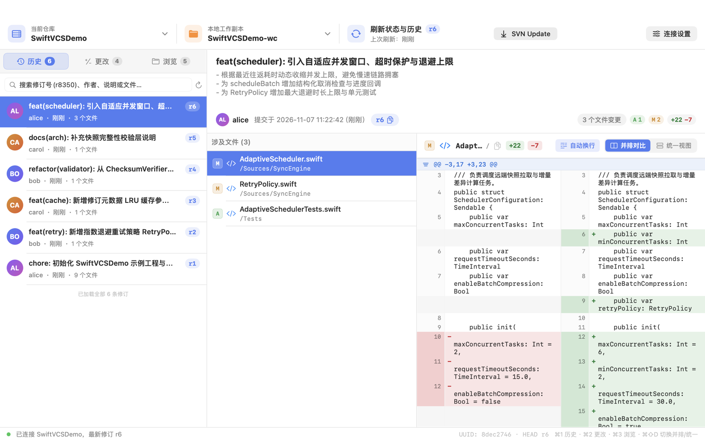
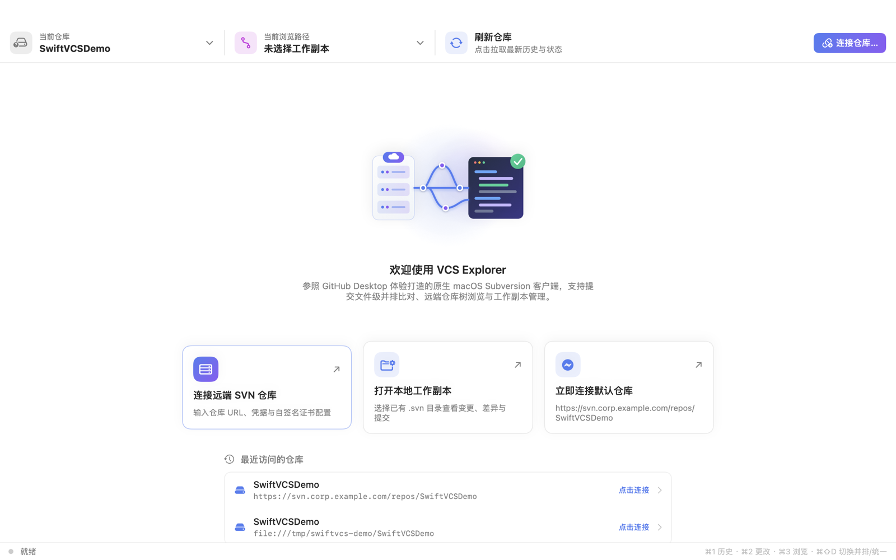
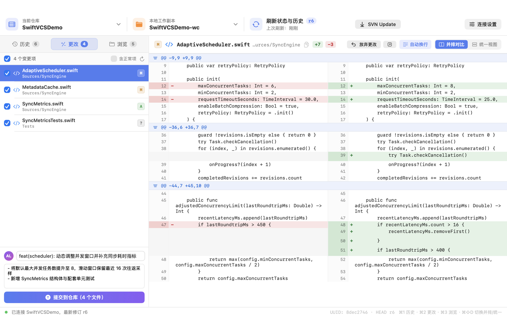
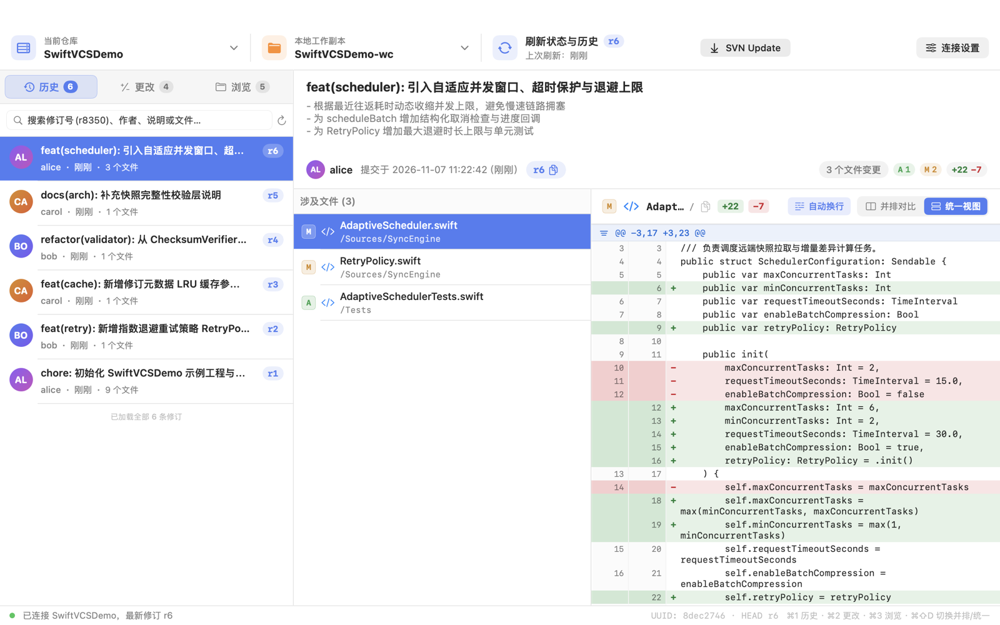
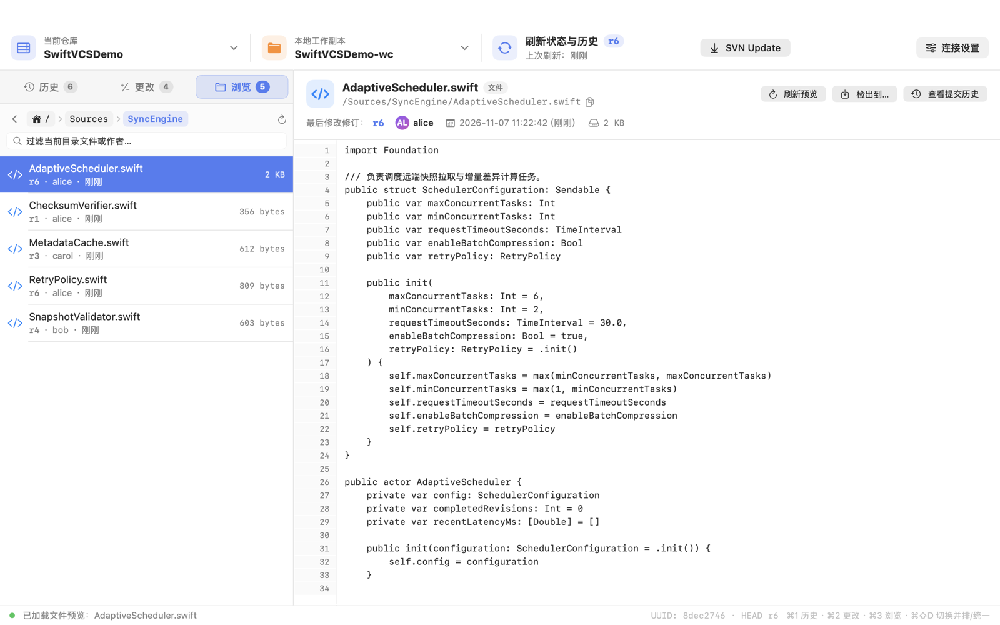
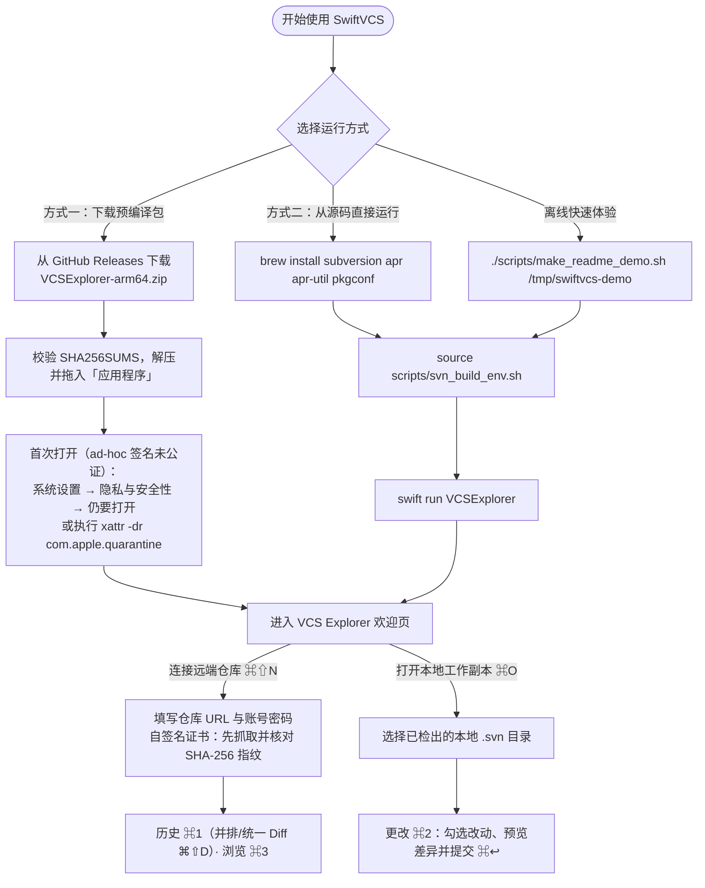
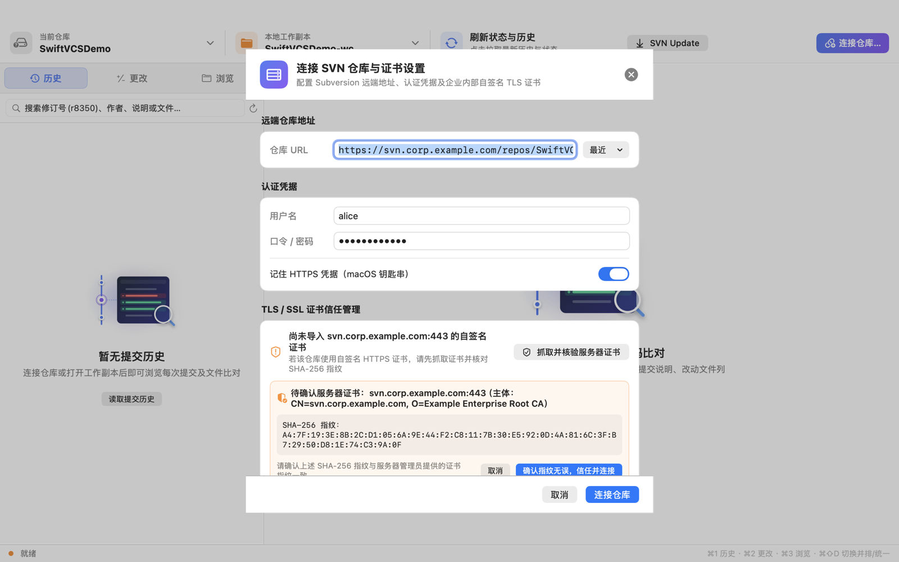
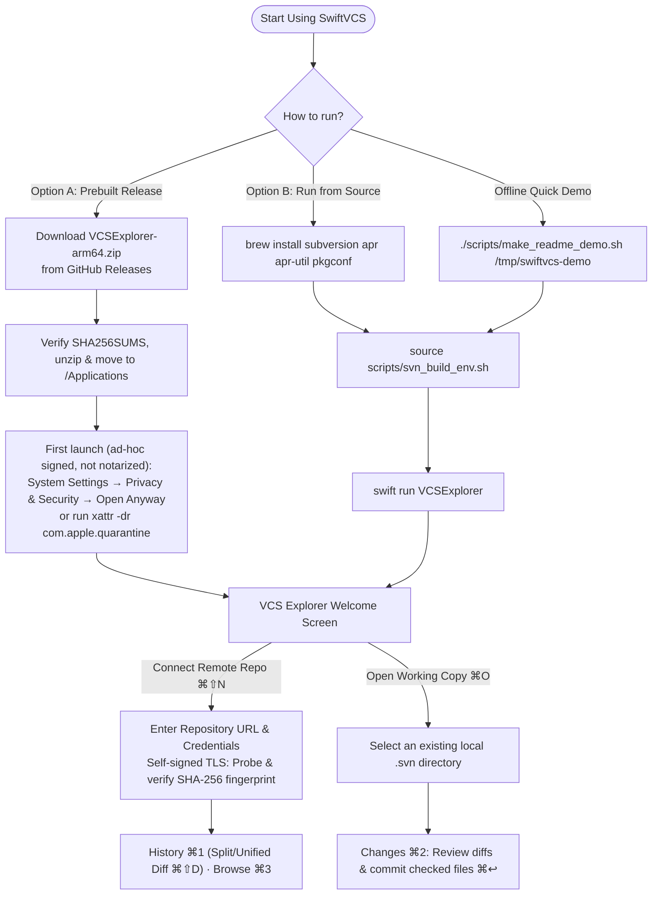

# SwiftVCS & VCS Explorer

<p align="center">
  <strong>Native macOS Subversion (SVN) Client & SDK built with Swift, SwiftUI, and C <code>libsvn</code></strong><br>
  <strong>基于 Swift、SwiftUI 与 C <code>libsvn</code> 构建的原生 macOS SVN 客户端与开发套件</strong>
</p>

<p align="center">
  <a href="#english-documentation">English</a> ·
  <a href="#简体中文文档">简体中文</a> ·
  <a href="./README_EN.md">README_EN.md</a> ·
  <a href="./README_ZH.md">README_ZH.md</a> ·
  <a href="./LICENSE">MIT License</a> ·
  <a href="./THIRD_PARTY_NOTICES.md">Third-Party Notices</a>
</p>

<p align="center">
  
</p>

---

## 简体中文文档

**SwiftVCS** 是一套面向 macOS (Apple Silicon / Intel) 的原生 Subversion (SVN) 客户端与分层 SDK。不同于通过 `Process` 调起外部 `svn` 命令行并解析文本输出的传统包装器，SwiftVCS 通过精简的 C 桥接层（`CSVNShim`）直接调用 **Apache Subversion (`libsvn_client-1` / `libsvn_ra-1` / `libsvn_wc-1` / `libsvn_diff-1`)** 原生 C API，并在上层提供 **GitHub Desktop 风格的原生 SwiftUI 图形界面（`VCS Explorer`）** 与 **全功能命令行工具（`vcsctl`）**。

### 核心特性

1. **五层清晰架构（零外部 CLI 进程依赖）**
   - `CVCSKit`：与具体版本控制系统无关的 Swift 领域模型与 `RepositoryClient` 异步协议（修订、目录树、工作副本状态、结构化 `FileDiff`、并排配对行 `SplitDiffRow`）。
   - `CSVNShim`：基于 APR 内存池（Subpool per-call）与线程安全封装的 C11 桥接层，直接对接 `libsvn` 1.14+。
   - `CSVNKit`：Swift 并发安全（`SVNClient`）的 SVN 客户端实现、多编码智能解码器（UTF-8 / GB18030 / GBK / UTF-16）、自签名 TLS 证书信任库（`TrustStore`）与本地凭据库（`KeychainStore`）。
   - `vcsctl`：覆盖连接、浏览、读取、检出、同步、状态、纳管、差异、提交、回滚、日志及提交级比对（`show`）的命令行工具。
   - `VCSExplorer`：参考 **GitHub Desktop** 交互设计的 macOS 原生 SwiftUI 桌面端。

2. **GitHub Desktop 风格界面 (`VCS Explorer`)**
   - **三段式顶部工具栏 (`RepoToolbar`)**：当前仓库快速切换弹窗、当前浏览路径/工作副本弹窗、一键刷新/`SVN Update` 状态按钮及 TLS 证书信任状态徽章。
   - **三页签侧边导航 (`SidebarView`)**：
     - **历史 (`History` `⌘1`)**：支持按修订号（如 `r8350`）、作者、提交说明、涉及文件路径实时过滤；彩色作者首字母头像、相对时间显示、滚到底部自动分页加载更多历史。
     - **更改 (`Changes` `⌘2`)**：本地工作副本变更勾选列表（刷新时保留用户勾选状态）、一键纳管（`svn add`）、带二次确认的单文件还原（`svn revert`）、底部提交框（必填摘要 + 详细描述，`⌘↩` 提交勾选文件）。
     - **浏览 (`Browse` `⌘3`)**：远端仓库目录树面包屑导航、目录内实时过滤、在线代码行号预览（支持 UTF-8 与 GB18030 中文源码，自动跳过二进制大文件）及「查看此路径提交历史」联动跳转。

3. **提交级文件差异比对 (`Commit File Diff`) — 并排对比 & 统一视图**
   - 点击任意历史提交即可查看该修订涉及的全部变更文件（新增 `A`、修改 `M`、删除 `D`、替换 `R` 及 `copyfrom` 源路径提示）。
   - 支持 **并排对比 (`Split`，默认)** 与 **统一视图 (`Unified`)** 一键切换（快捷键 `⌘⇧D`），支持自动换行与横向滚动切换（内置中日韩双宽字符与 Tab 宽度估算）。
   - 底层基于 `svn_client_diff_peg7` 与 `svn_client_diff7`：
     - 修改文件（`M`）：直接对比 `r(N-1)` 与 `rN`，属性变更无文本差异时明确提示；
     - 拷贝/移动并修改（`A+` / `R+`）：自动跨路径对比 `copyfrom_path@copyfrom_rev` 与 `path@rN` 的真实增量；
     - 纯新增/纯删除（`A` / `D`）：自动拉取文本内容合成全绿新增或全红删除视图；
     - 二进制文件（`.jar`、`.png`、`.pdf` 等）：毫秒级识别并展示二进制信息卡片，绝不阻塞 UI，且在工作副本混合改动时按 `Index:` 分段解码，不会因二进制 `NUL` 字节截断后续文本文件差异。

4. **企业内网自签名 HTTPS 证书两步核验 (`Two-Step TLS Fingerprint Verification`)**
   - 针对使用内部私有 CA 或自签名证书的企业 SVN 服务器，提供「抓取并核验服务器证书 → 展示证书主体（Subject）与 `SHA-256` 指纹 → 用户确认无误后仅对该 HTTPS 主机和端口信任叶证书」的两步安全信任流，避免盲目信任（Blind TOFU）。

### 界面预览

<table>
  <tr>
    <td width="50%"><br><sub><strong>欢迎页</strong>：一键连接远端 SVN 仓库、打开本地工作副本或访问最近仓库</sub></td>
    <td width="50%"><br><sub><strong>更改（<code>⌘2</code>）</strong>：工作副本状态勾选、一键纳管（<code>svn add</code>）、并排差异预览与提交</sub></td>
  </tr>
  <tr>
    <td width="50%"><br><sub><strong>历史（<code>⌘1</code>）</strong>：按修订/作者/路径过滤，支持并排与统一视图（<code>⌘⇧D</code>）一键切换</sub></td>
    <td width="50%"><br><sub><strong>浏览（<code>⌘3</code>）</strong>：远端目录树面包屑导航、在线代码行号预览与路径历史联动</sub></td>
  </tr>
</table>

### 系统架构图

```text
┌──────────────────────────────────────────────────────────────────────┐
│  Apps/VCSExplorer        GitHub Desktop 风格 SwiftUI 桌面端 (macOS 14+)│
│  Tools/vcsctl            全功能命令行工具                              │
├──────────────────────────────────────────────────────────────────────┤
│  Sources/CVCSKit         VCS 抽象协议 (RepositoryClient) 与公共数据模型 │
├──────────────────────────────────────────────────────────────────────┤
│  Sources/CSVNKit         SVNClient / 多编码 Diff 解析 / TrustStore    │
├──────────────────────────────────────────────────────────────────────┤
│  Sources/CSVNShim        libsvn C11 桥接 (csvn.h / csvn.c, APR 池管理) │
├──────────────────────────────────────────────────────────────────────┤
│  Apache Subversion       libsvn_client / ra / wc / diff / subr + APR │
└──────────────────────────────────────────────────────────────────────┘
```

### 快速开始（运行引导）与构建打包



#### 1. 环境要求
- **操作系统**：源码编译支持 **macOS 14.0 (Sonoma)** 或更高版本；GitHub Releases 预编译包的最低系统版本取决于打包内置的动态库版本，请以对应 Release 附带的 `build-info.txt` 为准（当前 `arm64` 预编译包要求 **macOS 15.0+**）。
- **开发工具**（仅源码构建需要）：Xcode Command Line Tools（Swift 5.9+）。
- **构建依赖**（仅源码构建与离线演示脚本需要；打包后的 `VCSExplorer.app` 已将全部 22 个依赖 `.dylib` 内置到 `Contents/Frameworks/`，目标机器无需安装 Homebrew）：

```bash
brew install subversion apr apr-util pkgconf
```

#### 2. 方式一：下载预编译包直接运行（Apple Silicon `arm64`）
每次推送 `main` 分支，CI 都会自动构建并发布经过校验的 Preview Release：

```bash
# 使用 GitHub CLI 下载最新预编译包与校验文件（也可直接在网页端 Releases 页面下载）
TAG=$(gh release list --repo ChingYung717/SwiftVCS -L 1 --json tagName -q '.[0].tagName')
gh release download "$TAG" --repo ChingYung717/SwiftVCS --pattern 'VCSExplorer-arm64.zip' --pattern 'SHA256SUMS' --pattern 'build-info.txt'
shasum -a 256 --check SHA256SUMS

# 解压并移入 /Applications
unzip -q VCSExplorer-arm64.zip
mv VCSExplorer.app /Applications/
```

> **首次打开提示**：预编译预览包采用 ad-hoc 签名且未公证（`Signature: ad hoc, not notarized`）。首次启动若遇到 macOS Gatekeeper 拦截，可在「**系统设置 → 隐私与安全性**」底部点击「**仍要打开**」，或在终端执行以下命令移除隔离属性后启动：
> ```bash
> xattr -dr com.apple.quarantine /Applications/VCSExplorer.app
> open /Applications/VCSExplorer.app
> ```

#### 3. 方式二：从源码直接启动图形界面 (`VCS Explorer`)

```bash
# 生成 pkg-config 配置并导出 PKG_CONFIG_PATH
source scripts/svn_build_env.sh

# 直接编译并启动 VCS Explorer 桌面端
swift run VCSExplorer
```

`VCSExplorer` 支持通过命令行启动参数直接打开指定仓库或本地工作副本：

| 启动参数 | 说明 |
|---|---|
| `--repo <URL>` | 启动后自动连接指定 SVN 仓库（支持 `https://`、`http://`、`svn://`、`svn+ssh://`、`file://`）并加载最近提交历史 |
| `--user <用户名>` | 预填 SVN 认证用户名 |
| `--wc <本地路径>` | 关联本地 `.svn` 工作副本目录；若未同时指定 `--repo`，启动后自动切到「更改 (`⌘2`)」页签 |
| `--selftest <URL> [工作副本]` | 不打开图形窗口，复用 `AppModel` 主链路执行离线端到端自检并输出逐项结果 |

> **安全建议**：避免在命令行参数中直接传递明文口令（会暴露在 Shell 历史与进程列表中）。请在界面「连接 SVN 仓库 (`⌘⇧N`)」弹窗中输入口令并开启「**记住 HTTPS 凭据（macOS 钥匙串）**」。

#### 4. 离线快速体验（无需远端 SVN 服务器）
若手头没有现成的 SVN 服务器，可使用仓库自带脚本在 `/tmp/swiftvcs-demo` 一键生成包含多作者提交历史、属性变更、历史复制（`copyfrom`）与未提交改动的本地 `file://` 演示仓库：

```bash
./scripts/make_readme_demo.sh /tmp/swiftvcs-demo
source scripts/svn_build_env.sh
swift run VCSExplorer \
  --repo file:///tmp/swiftvcs-demo/SwiftVCSDemo \
  --wc /tmp/swiftvcs-demo/SwiftVCSDemo-wc
```

#### 5. 首次连接与自签名 TLS 证书两步核验

<p align="center">
  
</p>

1. 启动后在欢迎页点击「**连接远端 SVN 仓库**」（或按快捷键 `⌘⇧N`）打开连接设置弹窗；
2. 输入仓库 URL、用户名与密码（可勾选保存至 macOS 钥匙串），以及可选的本地工作副本路径；
3. 若企业内网 SVN 使用**自签名或未知私有 CA 的 HTTPS 证书**，点击「**抓取并核验服务器证书**」，界面会先展示证书主体（Subject）与 `SHA-256` 指纹；与管理员提供的指纹核对一致后，点击「**确认指纹无误，信任并连接**」，即可仅为该 `host:port` 保存自签名/未知 CA 的叶证书信任例外（注意：该机制不是跨 CA 的严格证书固定，且 TLS 主机名 SAN/CN 与有效期仍始终强制校验）。

#### 6. 编译与运行测试

```bash
# Debug 构建全部模块 (CVCSKit, CSVNKit, vcsctl, VCSExplorer)
./scripts/svn_build_env.sh
source scripts/svn_build_env.sh
swift run SwiftVCSChecks

# 运行本地离线端到端测试套件与回环安全测试
./Tests/run_e2e.sh
python3 Tests/run_security.py "$(swift build --show-bin-path)/vcsctl"
```

#### 7. 打包独立可分发的应用包 (`VCSExplorer.app`) 与构建可复现说明 (SV-08 / SV-09)

```bash
./make_app.sh
```

执行 `./make_app.sh` 会自动：
1. 以 Release 模式编译 `VCSExplorer`；
2. 递归扫描并将 `libsvn_*`、`libapr*`、`libserf`、`libssl`、`libcrypto` 等 22 个非系统动态库拷入 `dist/VCSExplorer.app/Contents/Frameworks/`；
3. 将内置动态库加载路径重写为 `@rpath/<name>.dylib`，保留原始部署版本，并附带实际版本的许可证、NOTICE 和 gettext 源码；
4. 生成应用图标 `AppIcon.icns`、拷入空状态插画资源、执行 ad-hoc 代码签名与校验，最终输出：
   - `dist/VCSExplorer.app`
   - `dist/VCSExplorer-<架构>.zip`

- **预览包与正式发布状态说明（SV-09）**：`main` 分支 CI 自动发布的 `v<版本>-<短SHA>`（如 `v1.0.0-c4bfaef`）预发布标签产物属于面向开发验证的预览构建（ad-hoc 签名、未公证，附带 `SHA256SUMS` 与记录构建环境的 `build-info.txt`），不代表已完成 Apple Developer ID 签名与公证的语义化正式版本（`vX.Y.Z`）。正式分发时需通过 `SWIFTVCS_SIGN_IDENTITY` 指定 Developer ID Application 身份，并通过 `SWIFTVCS_NOTARY_PROFILE` 执行公证。
- **依赖版本基线与构建可复现说明（SV-08）**：本地与 CI 通过 `scripts/svn_build_env.sh` 绑定 Homebrew 的 `subversion`（验证基线 `1.15.0` / `serf 1.3.10`）、`apr`（`1.7.6`）、`apr-util`（`1.6.6`）、`openssl@3`（`3.5.9`）、`sqlite`（`3.54.1`）、`utf8proc`（`2.12.0`）、`lz4`（`1.10.0`）。由于 Apple 链接器会将目标文件时间戳（`N_OSO` stab 条目）哈希进 Mach-O `LC_UUID`，且 `codesign` 会据此生成不同的 `LC_CODE_SIGNATURE` CDHash，两次独立干净构建产物的二进制哈希会因 `LC_UUID` 与签名块而不同；请以每次构建产物附带的 `build-info.txt` 与 `SHA256SUMS` 校验包完整性。

### 命令行工具 `vcsctl` 速查

```bash
# 推荐通过 --password-stdin 从标准输入传入密码（避免在 ps / Shell 历史中暴露口令），可用 --remember 保存至 macOS 钥匙串
printf '%s\n' '***' | vcsctl info https://svn.example.com/repo --user alice --password-stdin --remember

# 先查看指纹，再用管理员通过独立渠道提供的指纹确认（针对该 host:port 的自签名/未知 CA 证书例外，仍强制校验主机名与有效期）
vcsctl info https://svn.example.com/repo --fetch-cert svn.example.com
vcsctl info https://svn.example.com/repo --fetch-cert svn.example.com --fingerprint '<经核验的 SHA-256 指纹>'

# 浏览远端目录与读取文件内容
vcsctl ls   https://svn.example.com/repo trunk/src
vcsctl cat  https://svn.example.com/repo trunk/src/main.swift --revision 42

# 查看某次历史提交的变更文件列表与 Unified Diff（支持位置参数或 -r）
vcsctl show https://svn.example.com/repo 42
vcsctl show https://svn.example.com/repo 42 trunk/src/main.swift

# 工作副本常用操作
vcsctl checkout https://svn.example.com/repo /path/to/wc
vcsctl status   /path/to/wc
vcsctl add      /path/to/wc src/new_file.swift
vcsctl diff     /path/to/wc
vcsctl commit   /path/to/wc -m "feat: add new_file.swift"
vcsctl revert   /path/to/wc src/new_file.swift
vcsctl update   /path/to/wc
vcsctl log      /path/to/wc --limit 50
```

---

## English Documentation

**SwiftVCS** is a native macOS Subversion (SVN) client and layered SDK written in Swift, SwiftUI, and C11. Instead of spawning `svn` child processes and scraping stdout, SwiftVCS links directly against **Apache Subversion (`libsvn_client-1`, `libsvn_ra-1`, `libsvn_wc-1`, `libsvn_diff-1`)** via a thread-safe C shim (`CSVNShim`) with per-operation APR subpool lifecycle management. It ships with both a **GitHub Desktop-inspired SwiftUI application (`VCS Explorer`)** and a **full-featured CLI (`vcsctl`)**.

### Key Highlights

1. **Five-Layer Native Architecture**
   - **`CVCSKit`**: VCS-agnostic Swift domain models and the async `RepositoryClient` protocol (`RepositoryInfo`, `RepositoryEntry`, `WorkingCopyStatus`, `LogEntry`, `ChangedPath`, `FileDiff`, `SplitDiffRow`).
   - **`CSVNShim`**: C11 bridge (`csvn.h` / `csvn.c`) wrapping `libsvn` with APR subpools, streaming output caps (`max_bytes`), and thread-local error propagation.
   - **`CSVNKit`**: Concurrency-safe `SVNClient`, multi-encoding text decoder (UTF-8, GB18030, GBK, UTF-16, ISO-8859-1), `TrustStore` for custom/self-signed TLS CAs, and `KeychainStore` (macOS Keychain, scoped to the HTTPS repository and authentication realm).
   - **`vcsctl`**: Command-line interface supporting `info`, `ls`, `cat`, `checkout`, `update`, `status`, `add`, `diff`, `commit`, `revert`, `log`, and commit-level `show`.
   - **`VCSExplorer`**: Native macOS SwiftUI desktop client modeled after **GitHub Desktop**.

2. **GitHub Desktop-Style UI (`VCS Explorer`)**
   - **Three-Segment Top Toolbar (`RepoToolbar`)**: Repository switcher popover, current browse path / working copy switcher popover, one-click Refresh / `SVN Update` status button, and TLS trust status badge.
   - **Three Sidebar Tabs (`SidebarView`)**:
     - **History (`⌘1`)**: Instant filtering by revision (`r8350`), author, commit message, or changed file path; deterministic author avatar badges; relative timestamps; infinite scroll pagination.
     - **Changes (`⌘2`)**: Working copy file checklist (preserving user selection across refreshes), one-click stage (`svn add`), confirmed discard (`svn revert`), and a GitHub Desktop commit box (`⌘↩` to commit checked paths).
     - **Browse (`⌘3`)**: Interactive breadcrumb bar, in-folder search filter, line-numbered remote file preview, and one-click "View Commit History for Path".

3. **Commit-Level File Diff (`Split` & `Unified` Views)**
   - Inspect every file changed in any revision (`A`, `M`, `D`, `R`, plus `copyfrom` provenance).
   - Toggle seamlessly between **Side-by-Side (`Split`)** and **Unified** diff modes (`⌘⇧D`), with soft-wrap or horizontal scroll (aware of CJK double-width glyphs and tab stops).
   - Powered by `svn_client_diff_peg7` and `svn_client_diff7`: accurately diffs copied/moved files against their `copyfrom` source, synthesizes full-file additions/deletions when appropriate, skips binary files (`.jar`, `.png`, `.pdf`, etc.) without blocking the UI, and decodes multi-file working copy diffs section-by-section so binary `NUL` bytes never truncate subsequent text file diffs.

4. **Two-Step TLS Certificate Fingerprint Verification**
   - For enterprise SVN servers using self-signed certificates or private CAs, `VCS Explorer` probes the server certificate first, displays its Subject and `SHA-256` fingerprint, and only trusts that leaf certificate for its HTTPS host and port after confirmation.

### Screenshots

<table>
  <tr>
    <td width="50%"><br><sub><strong>Welcome</strong>: Connect to a remote SVN repository, open a local working copy, or jump to recent repositories</sub></td>
    <td width="50%"><br><sub><strong>Changes (<code>⌘2</code>)</strong>: Working copy checklist, one-click stage (<code>svn add</code>), side-by-side diff preview, and commit box</sub></td>
  </tr>
  <tr>
    <td width="50%"><br><sub><strong>History (<code>⌘1</code>)</strong>: Instant filtering by revision/author/path, with instant Split & Unified view toggle (<code>⌘⇧D</code>)</sub></td>
    <td width="50%"><br><sub><strong>Browse (<code>⌘3</code>)</strong>: Interactive breadcrumb navigation, line-numbered remote file preview, and path log jump</sub></td>
  </tr>
</table>

### Getting Started, Build & Standalone Packaging



#### Option A: Download Prebuilt App Bundle (Apple Silicon `arm64`)
Every push to `main` publishes a verified preview bundle on GitHub Releases:

```bash
# Download the latest preview bundle and checksums via GitHub CLI (or from the Releases page)
TAG=$(gh release list --repo ChingYung717/SwiftVCS -L 1 --json tagName -q '.[0].tagName')
gh release download "$TAG" --repo ChingYung717/SwiftVCS --pattern 'VCSExplorer-arm64.zip' --pattern 'SHA256SUMS' --pattern 'build-info.txt'
shasum -a 256 --check SHA256SUMS

unzip -q VCSExplorer-arm64.zip
mv VCSExplorer.app /Applications/
```

> **First-Launch Note**: Preview bundles are ad-hoc signed and not notarized (`Signature: ad hoc, not notarized`), and their minimum macOS version is determined by the bundled dynamic libraries as recorded in `build-info.txt` (currently **macOS 15.0+**). On first launch, either click **Open Anyway** under **System Settings → Privacy & Security**, or strip the quarantine attribute:
> ```bash
> xattr -dr com.apple.quarantine /Applications/VCSExplorer.app
> open /Applications/VCSExplorer.app
> ```

#### Option B: Build & Launch from Source (`macOS 14.0+`)

```bash
# 1. Install build-time dependencies via Homebrew (Apple Silicon or Intel)
brew install subversion apr apr-util pkgconf

# 2. Export PKG_CONFIG_PATH and launch the GUI directly
source scripts/svn_build_env.sh
swift run VCSExplorer
```

Supported launch arguments for `VCSExplorer`:

| Argument | Description |
|---|---|
| `--repo <URL>` | Automatically connect to the given SVN repository (`https://`, `http://`, `svn://`, `svn+ssh://`, or `file://`) and load recent history |
| `--user <name>` | Pre-fill the SVN authentication username |
| `--wc <path>` | Associate a local `.svn` working copy; opens directly on the **Changes (`⌘2`)** tab when `--repo` is omitted |
| `--selftest <URL> [wc]` | Run headless end-to-end verification through `AppModel` without opening a window |

> **Security Tip**: Avoid passing plaintext passwords on the command line (which exposes them in shell history and process listings). Enter passwords in the **Connect Repository (`⌘⇧N`)** sheet and enable **Remember HTTPS credentials (macOS Keychain)**.

#### Try It Offline (No SVN Server Required)
Generate a self-contained local `file://` demo repository (with multi-author commits, property changes, `copyfrom` history, and uncommitted working copy edits) in one command:

```bash
./scripts/make_readme_demo.sh /tmp/swiftvcs-demo
source scripts/svn_build_env.sh
swift run VCSExplorer \
  --repo file:///tmp/swiftvcs-demo/SwiftVCSDemo \
  --wc /tmp/swiftvcs-demo/SwiftVCSDemo-wc
```

#### First-Time Connection & Two-Step TLS Verification

<p align="center">
  
</p>

1. Click **Connect Remote SVN Repository** on the welcome screen (or press `⌘⇧N`);
2. Enter the repository URL, username, password (optionally saved to macOS Keychain), and local working copy path;
3. For self-signed or unknown-CA HTTPS servers, click **Probe & Verify Server Certificate** (`抓取并核验服务器证书`), verify the displayed Subject and `SHA-256` fingerprint against your administrator's fingerprint, and click **Confirm & Connect** (`确认指纹无误，信任并连接`) to store a `host:port` trust exception for that self-signed/unknown-CA leaf certificate (note: this is not cross-CA strict pinning, and TLS hostname SAN/CN and validity period are still strictly enforced).

#### Build, Test & Standalone Packaging

```bash
# 1. Build all targets and run unit checks
./scripts/svn_build_env.sh
source scripts/svn_build_env.sh
swift run SwiftVCSChecks

# 2. Run the offline E2E and loopback security test suites
./Tests/run_e2e.sh
python3 Tests/run_security.py "$(swift build --show-bin-path)/vcsctl"

# 3. Package a standalone, self-contained macOS app bundle
./make_app.sh
# Outputs:
#   dist/VCSExplorer.app (bundles all 22 libsvn/libapr/libserf dylibs under Contents/Frameworks/ via @rpath)
#   dist/VCSExplorer-<arch>.zip
```

- **Preview vs. Formal Release (SV-09)**: `v<version>-<shortSHA>` (e.g. `v1.0.0-c4bfaef`) prerelease artifacts published from `main` are ad-hoc signed, unnotarized preview builds accompanied by `SHA256SUMS` and `build-info.txt`; formal semantic releases (`vX.Y.Z`) require Apple Developer ID signing (`SWIFTVCS_SIGN_IDENTITY`) and notarization (`SWIFTVCS_NOTARY_PROFILE`).
- **Build Reproducibility & Dependency Baseline (SV-08)**: Verified against `subversion 1.15.0` (`serf 1.3.10`), `apr 1.7.6`, `apr-util 1.6.6`, `openssl@3 3.5.9`, `sqlite 3.54.1`, `utf8proc 2.12.0`, and `lz4 1.10.0`. Because Apple's linker hashes `.o` modification timestamps (`N_OSO` stabs) into `LC_UUID` and `codesign` derives a corresponding `LC_CODE_SIGNATURE` CDHash, two clean builds will differ in `LC_UUID` and signature bytes; use the per-build `SHA256SUMS` and `build-info.txt` to verify artifact integrity.

---

To consume `CSVNKit` from another Swift package, install the Homebrew dependencies and source `scripts/svn_build_env.sh` from a SwiftVCS checkout before building the consumer. SwiftPM uses the exported `PKG_CONFIG_PATH` to find the native libraries.

## 工作副本协作 / Working copy collaboration

在「更改」页开启「含正常项」，右键已纳管文件即可删除、改名、移动或保留历史复制。更新后的文本冲突可采用当前文件、基线、传入版本或冲突前本地版本。工作副本菜单支持同仓库的指定修订合并，先预演再应用。文件操作和合并结果由用户审核后提交。

In Changes, enable normal entries to access delete, rename, move and history-preserving copy. Resolve text conflicts from the file menu. Preview and apply a same-repository revision merge from the working copy menu, then review and commit its files and merge metadata.

```bash
vcsctl rename /path/to/wc src/old.swift new.swift
vcsctl copy /path/to/wc src/new.swift src/example.swift
vcsctl resolve /path/to/wc src/example.swift --strategy current
vcsctl merge /path/to/wc --source https://svn.example.com/repo/branches/feature --revision 42 --dry-run
```

[界面与 CLI 集成 / GUI and CLI integration](docs/FRONTEND_INTEGRATION.md)

## 开源协议与第三方声明 / License & Third-Party Notices

- **SwiftVCS 源码协议 / Source License**：本项目源代码采用 **[MIT License](./LICENSE)** 开源。
- **第三方开源组件声明 / Third-Party Notices**：预编译或通过 `./make_app.sh` 打包生成的 `VCSExplorer.app` 内置了 Apache Subversion (`libsvn_*`)、Apache Portable Runtime (`libapr` / `libapr-util`)、Apache Serf (`libserf`)、OpenSSL (`libssl` / `libcrypto`)、LZ4 与 utf8proc 等动态库，其各自的开源许可证（Apache License 2.0、BSD License、MIT License 等）详见 **[THIRD_PARTY_NOTICES.md](./THIRD_PARTY_NOTICES.md)**。
- **贡献指南与安全策略 / Contributing & Security**：请参阅 **[CONTRIBUTING.md](./CONTRIBUTING.md)** 与 **[SECURITY.md](./SECURITY.md)**。
