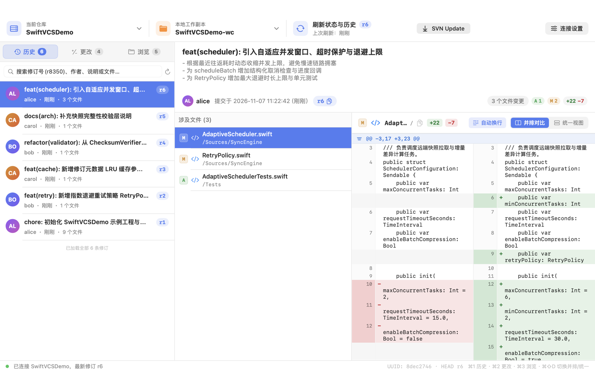
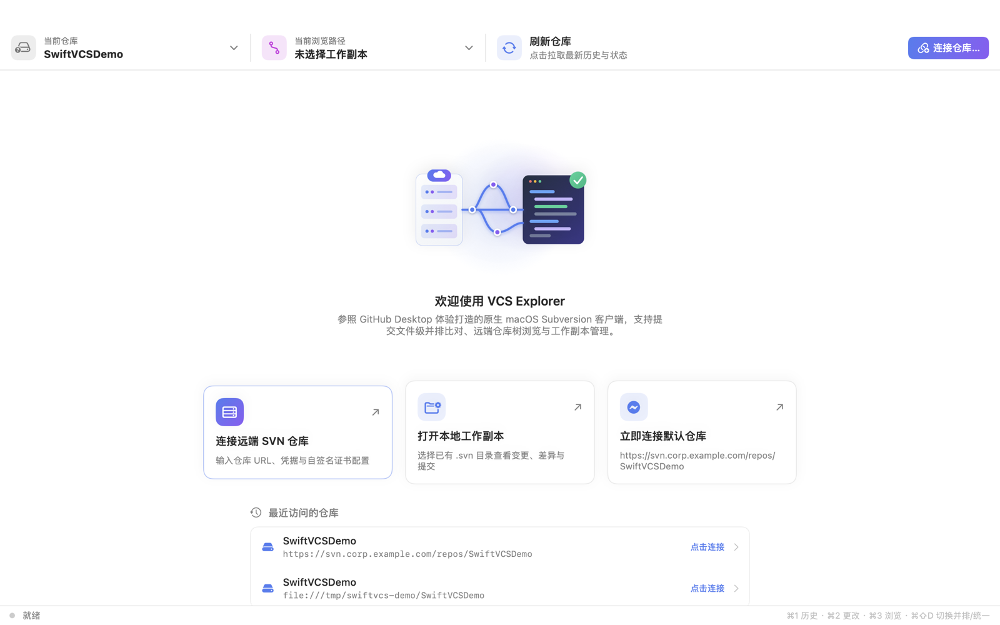
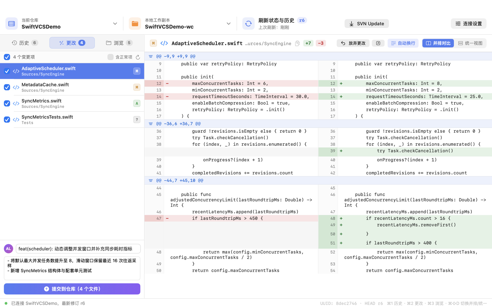
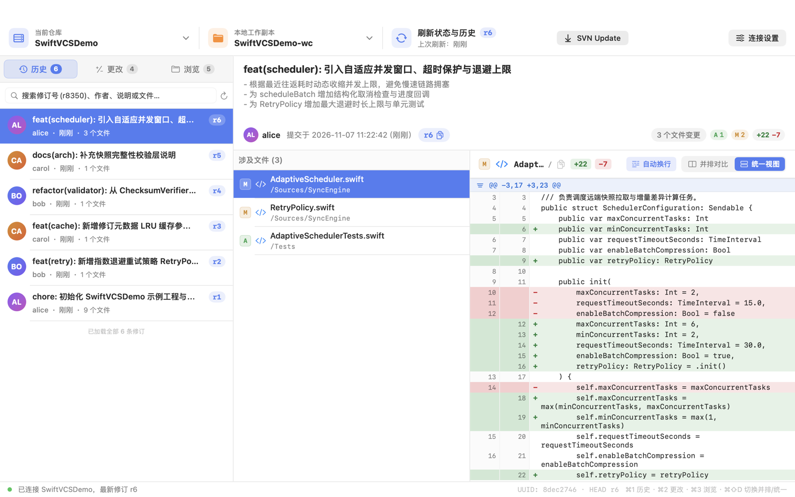
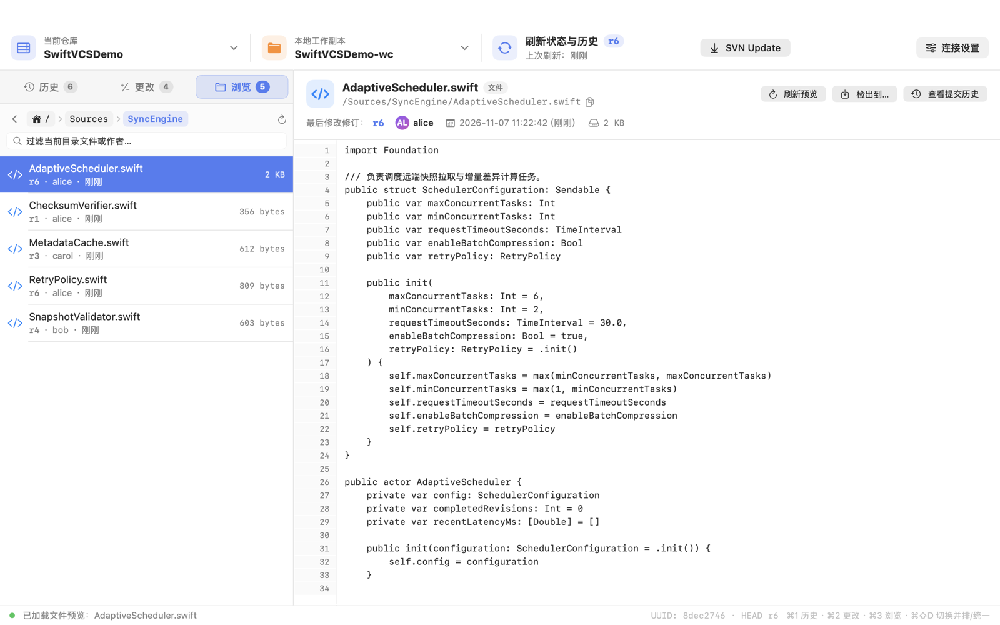
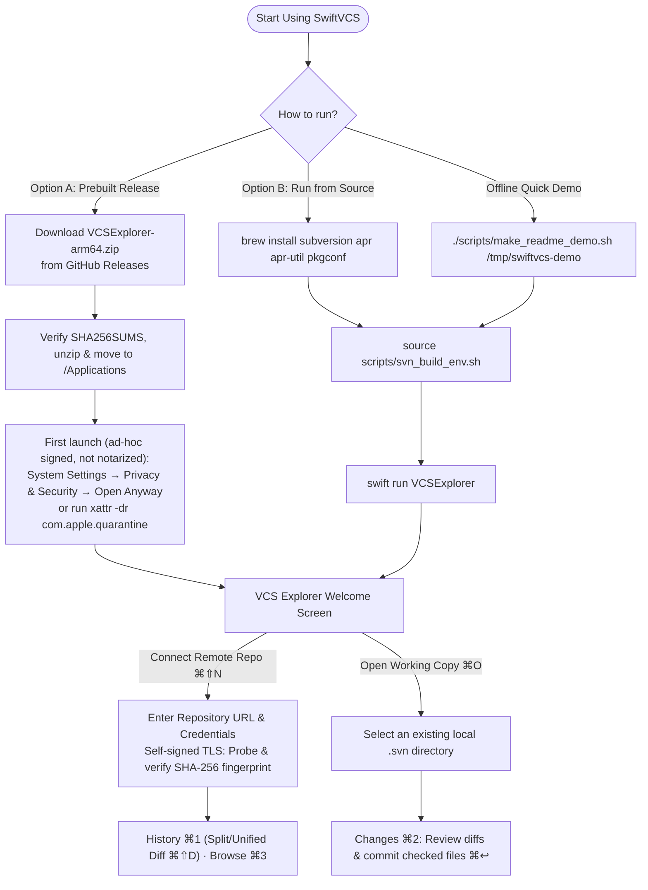
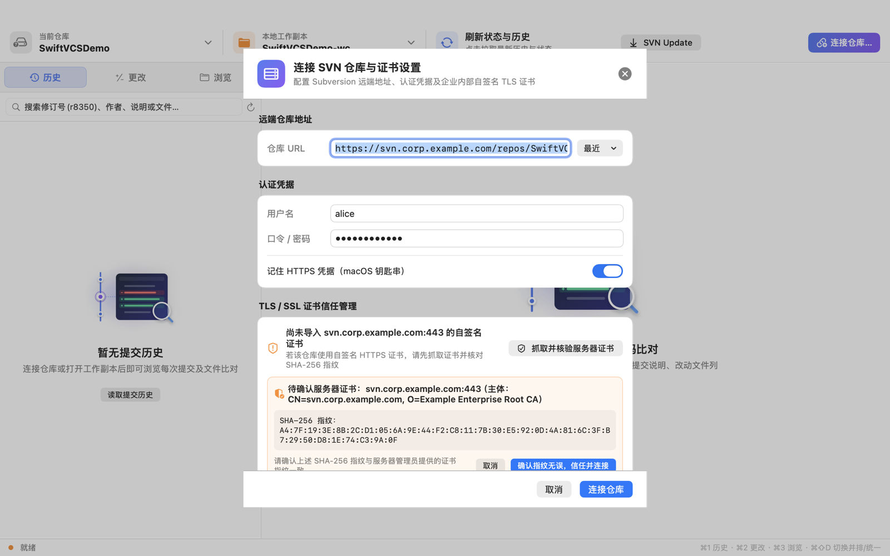

# SwiftVCS & VCS Explorer (English Documentation)

<p align="left">
  <a href="./README.md">Bilingual Main README</a> ·
  <a href="./README_ZH.md">简体中文文档 (README_ZH.md)</a> ·
  <a href="./LICENSE">MIT License</a> ·
  <a href="./THIRD_PARTY_NOTICES.md">Third-Party Notices</a>
</p>

**SwiftVCS** is a native macOS Subversion (SVN) client and layered SDK built with Swift, SwiftUI, and C11. Rather than invoking external `svn` CLI processes and parsing text output, SwiftVCS bridges directly to **Apache Subversion (`libsvn_client-1`, `libsvn_ra-1`, `libsvn_wc-1`, `libsvn_diff-1`)** through a thread-safe C shim (`CSVNShim`) and provides both a **GitHub Desktop-inspired macOS app (`VCS Explorer`)** and a **command-line tool (`vcsctl`)**.

<p align="center">
  
</p>

---

## 1. Architecture

```text
SwiftVCS/
├── Package.swift                 # SwiftPM manifest (macOS 14+, uses pkg-config)
├── Sources/
│   ├── CVCSKit/                  # VCS-agnostic domain types & async RepositoryClient protocol
│   ├── CSVNShim/                 # C11 bridge over libsvn_client / ra / wc / diff with APR subpools
│   └── CSVNKit/                  # SVNClient, multi-encoding diff parser, TrustStore & KeychainStore
├── Tools/
│   └── vcsctl/                   # Full-featured CLI client
├── Apps/
│   └── VCSExplorer/              # GitHub Desktop-style SwiftUI macOS application (15 view/model files)
├── Tests/
│   ├── CVCSKitTests/             # Unit test target
│   └── run_e2e.sh                # offline end-to-end test suite (file:// repository)
└── make_app.sh                   # Standalone .app bundler (rewrites 22 dylibs into Contents/Frameworks)
```

---

## 2. Features

| Capability | Underlying `libsvn` API | Description |
|---|---|---|
| **1. Connect & Inspect** | `svn_client_uuid_from_url`, `svn_ra_get_latest_revnum`, `svn_ra_get_repos_root2` | Connects to remote repositories or subdirectories, resolves repository root URL, UUID, and HEAD revision. |
| **2. Remote Browse (`ls` & `cat`)** | `svn_client_ls3`, `svn_client_cat2` | Lists remote directories with author/revision/size metadata and previews remote files with UTF-8 / GB18030 auto-detection. |
| **3. Checkout** | `svn_client_checkout3` | Checks out full repositories or subdirectories at HEAD or a specific peg revision. |
| **4. Update** | `svn_client_update4` | Updates working copies to the latest revision. |
| **5. Working Copy Status & Stage** | `svn_client_status6`, `svn_client_add5` | Scans modified, added, deleted, conflicted, and unversioned files; stages unversioned paths. |
| **6. Working Copy Diff** | `svn_client_diff6` | Parses multi-file unified diffs without truncating on binary `NUL` bytes. |
| **7. Commit** | `svn_client_commit6` | Commits selected paths with summary and description. |
| **8. Revert** | `svn_client_revert4` | Reverts local modifications on files or directories. |
| **9. Commit History (`log`)** | `svn_client_log5` | Streams commit logs with changed paths, node kinds (`file`/`dir`), and `copyfrom` metadata; supports pagination. |
| **10. Commit-Level File Diff** | `svn_client_diff_peg7`, `svn_client_diff7` | Computes per-file diffs for any historical commit (`M`, `A`, `D`, `R`, `A+` copy+modify) in **Split (Side-by-Side)** or **Unified** view. |

---

## 3. Screenshots

<table>
  <tr>
    <td width="50%"><br><sub><strong>Welcome</strong>: Connect to a remote SVN repository, open a local working copy, or jump to recent repositories</sub></td>
    <td width="50%"><br><sub><strong>Changes (<code>⌘2</code>)</strong>: Working copy checklist, one-click stage (<code>svn add</code>), side-by-side diff preview, and commit box</sub></td>
  </tr>
  <tr>
    <td width="50%"><br><sub><strong>History (<code>⌘1</code>)</strong>: Instant filtering by revision/author/path, with instant Split & Unified view toggle (<code>⌘⇧D</code>)</sub></td>
    <td width="50%"><br><sub><strong>Browse (<code>⌘3</code>)</strong>: Interactive breadcrumb navigation, line-numbered remote file preview, and path log jump</sub></td>
  </tr>
</table>

---

## 4. Getting Started, Building & Packaging



### Prerequisites
- **macOS**: Building from source supports **macOS 14.0 (Sonoma)** or later (Apple Silicon `arm64` or Intel `x86_64`). Prebuilt release bundles inherit the deployment target of their bundled Homebrew dynamic libraries as recorded in `build-info.txt` (currently **macOS 15.0+**).
- Xcode Command Line Tools (`xcode-select --install`, required for building from source)
- Homebrew `subversion` and `apr` (required on the build machine or for the offline demo script only):

```bash
brew install subversion apr apr-util pkgconf
```

### Option A: Download Prebuilt App Bundle (Apple Silicon `arm64`)

```bash
gh release download --repo ChingYung717/SwiftVCS --pattern 'VCSExplorer-arm64.zip' --pattern 'SHA256SUMS' --pattern 'build-info.txt'
shasum -a 256 --check SHA256SUMS

unzip -q VCSExplorer-arm64.zip
mv VCSExplorer.app /Applications/
```

> **First-Launch Note**: Preview bundles are ad-hoc signed and not notarized (`Signature: ad hoc, not notarized`). On first launch, either click **Open Anyway** in **System Settings → Privacy & Security**, or remove the quarantine attribute:
> ```bash
> xattr -dr com.apple.quarantine /Applications/VCSExplorer.app
> open /Applications/VCSExplorer.app
> ```

### Option B: Launch `VCS Explorer` from Source

```bash
source scripts/svn_build_env.sh
swift run VCSExplorer
```

Supported launch arguments:

| Argument | Description |
|---|---|
| `--repo <URL>` | Automatically connect to the given SVN repository (`https://`, `http://`, `svn://`, `svn+ssh://`, or `file://`) and load recent history |
| `--user <name>` | Pre-fill the SVN authentication username |
| `--wc <path>` | Associate a local `.svn` working copy; opens directly on the **Changes (`⌘2`)** tab when `--repo` is omitted |
| `--selftest <URL> [wc]` | Run headless end-to-end verification through `AppModel` without opening a window |

> **Security Tip**: Avoid passing plaintext passwords on the command line. Enter passwords in the **Connect Repository (`⌘⇧N`)** sheet and enable **Remember HTTPS credentials (macOS Keychain)**.

### Try It Offline (No SVN Server Required)

```bash
./scripts/make_readme_demo.sh /tmp/swiftvcs-demo
source scripts/svn_build_env.sh
swift run VCSExplorer \
  --repo file:///tmp/swiftvcs-demo/SwiftVCSDemo \
  --wc /tmp/swiftvcs-demo/SwiftVCSDemo-wc
```

### First-Time Connection & Two-Step TLS Verification

<p align="center">
  
</p>

1. Click **Connect Remote SVN Repository** on the welcome screen (or press `⌘⇧N`);
2. Enter the repository URL, username, password (optionally saved to macOS Keychain), and local working copy path;
3. For self-signed HTTPS servers, click **Probe & Verify Server Certificate** (`抓取并核验服务器证书`), verify the displayed Subject and `SHA-256` fingerprint against your administrator's fingerprint, and click **Confirm & Connect** (`确认指纹无误，信任并连接`).

### Build & Run Tests

```bash
./scripts/svn_build_env.sh
source scripts/svn_build_env.sh
swift run SwiftVCSChecks
./Tests/run_e2e.sh
```

### Build Standalone `VCSExplorer.app`

```bash
./make_app.sh
```

`make_app.sh` builds the Release executable, copies all required `libsvn_*`, `libapr*`, `libserf`, and `libssl` dynamic libraries into `dist/VCSExplorer.app/Contents/Frameworks/`, rewrites load paths to `@rpath`, preserves each library’s deployment target, includes the licenses and gettext source, and produces `dist/VCSExplorer-<arch>.zip`. The default ad-hoc signature is for local testing. For distribution, set `SWIFTVCS_SIGN_IDENTITY` and `SWIFTVCS_NOTARY_PROFILE` to use Developer ID and notarization.

---

## 5. License

SwiftVCS is released under the **[MIT License](./LICENSE)**. See **[THIRD_PARTY_NOTICES.md](./THIRD_PARTY_NOTICES.md)** for licenses of bundled third-party libraries (Apache Subversion, APR, Serf, OpenSSL, LZ4, utf8proc).

## Working copy collaboration

Enable normal entries in Changes to delete, rename, move, or copy versioned files with history. Text conflicts support current, base, incoming and local resolution. Use the working copy menu to preview and apply a same-repository single revision or forward range. Review both file changes and `svn:mergeinfo` before committing.

[GUI and CLI integration](docs/FRONTEND_INTEGRATION.md)

## Node properties and working-copy directories

Open **Node Properties** from a versioned file or directory in Changes (enable normal items when needed). The working-copy menu offers root properties, ignore rules, and directory creation with a preview. Repository Browse offers read-only properties. Property edits and new directories stay local until you explicitly commit.

```bash
vcsctl proplist ./wc --path src --inherited
vcsctl propget https://svn.example.org/project/trunk project:label --revision 42 --peg 42 --raw
vcsctl propset ./wc svn:ignore '*.local' --path src
vcsctl propset ./wc project:payload --file payload.bin --path src/example.txt
vcsctl propdel ./wc project:payload --path src/example.txt
vcsctl ignore ./wc --path src
vcsctl mkdir ./wc docs/guides --parents
```

Working-copy edits support custom properties and `svn:ignore`, `svn:eol-style`, `svn:keywords`, and `svn:mime-type`. Local property paths default to the working-copy root. Omit `--parents` to require an existing versioned parent. See [GUI and CLI integration](docs/FRONTEND_INTEGRATION.md).

### Review SVN property changes

The working-copy diff, commit history, and `vcsctl diff` / `vcsctl show` display each changed direct node property with its old and new values. Empty and absent values are distinct, and binary values show their byte counts. Property review also works for directories and binary files.
