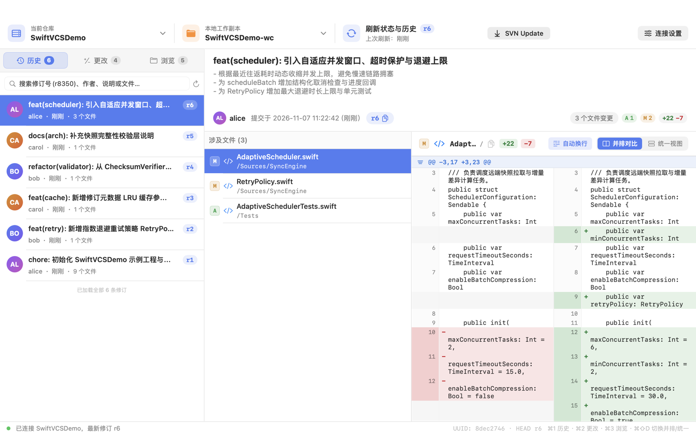
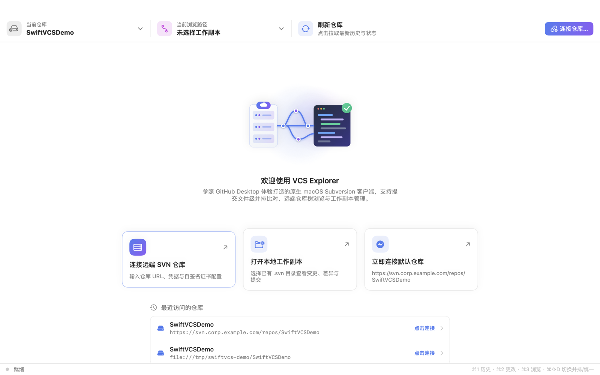
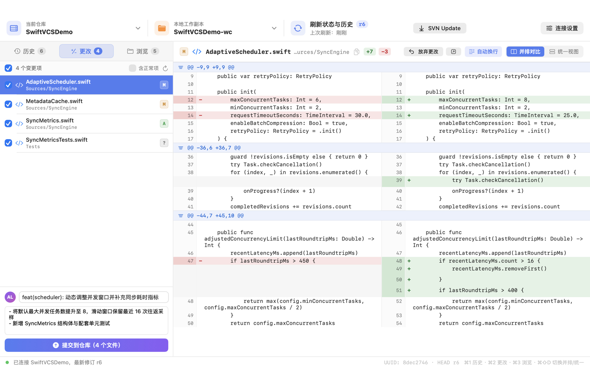
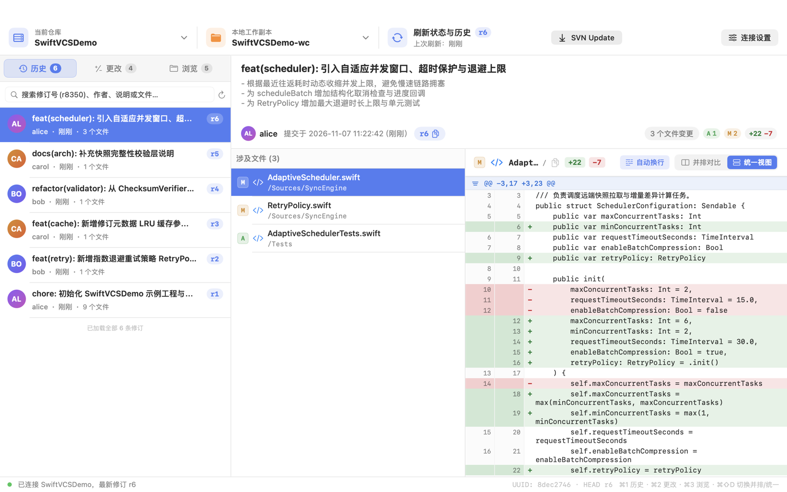
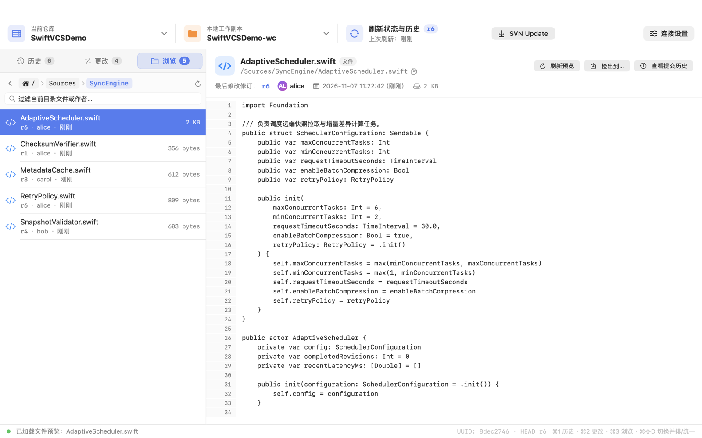
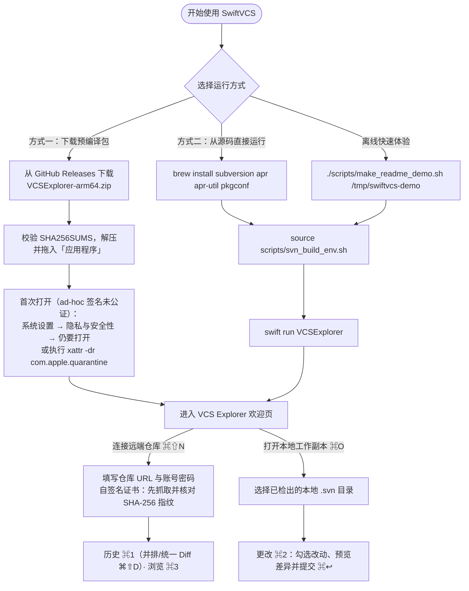
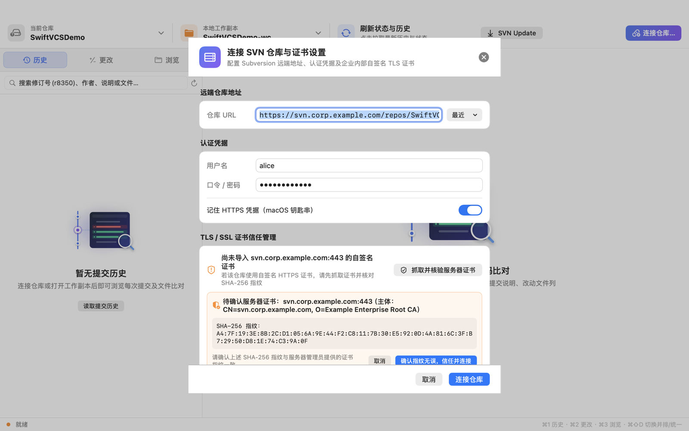

# SwiftVCS & VCS Explorer（简体中文详细文档）

<p align="left">
  <a href="./README.md">中英双语主文档 (README.md)</a> ·
  <a href="./README_EN.md">English Documentation (README_EN.md)</a> ·
  <a href="./LICENSE">MIT 开源协议</a> ·
  <a href="./THIRD_PARTY_NOTICES.md">第三方开源组件声明</a>
</p>

**SwiftVCS** 是面向 macOS 的原生 Subversion (SVN) 客户端与分层开发套件。它通过 C11 桥接层（`CSVNShim`）直接调用 `libsvn_client` 等原生 C 接口，提供 **GitHub Desktop 风格的图形界面（`VCS Explorer`）** 与 **命令行工具（`vcsctl`）**。

<p align="center">
  
</p>

---

## 1. 模块划分与工程结构

```text
SwiftVCS/
├── Package.swift                 # SwiftPM 包配置（支持 macOS 14+，通过 pkg-config 加载系统库）
├── Sources/
│   ├── CVCSKit/                  # 与具体 VCS 无关的公共协议 (RepositoryClient) 与值类型模型
│   ├── CSVNShim/                 # libsvn 1.14+ C11 封装层（APR 子内存池管理、流式限流、线程局部错误）
│   └── CSVNKit/                  # SVNClient 实现、多编码 Diff 解析器、TrustStore 与 KeychainStore
├── Tools/
│   └── vcsctl/                   # 命令行工具
├── Apps/
│   └── VCSExplorer/              # GitHub Desktop 风格 SwiftUI 桌面端（15 个源码文件 + 图标与插画资源）
├── Tests/
│   ├── CVCSKitTests/             # 单元测试目录
│   └── run_e2e.sh                # 离线端到端回归测试脚本（基于本地 file:// 仓库）
└── make_app.sh                   # 独立 .app 打包脚本（内置 22 个动态库至 Contents/Frameworks）
```

---

## 2. 界面预览

<table>
  <tr>
    <td width="50%"><br><sub><strong>欢迎页</strong>：一键连接远端 SVN 仓库、打开本地工作副本或访问最近仓库</sub></td>
    <td width="50%"><br><sub><strong>更改（<code>⌘2</code>）</strong>：工作副本状态勾选、一键纳管（<code>svn add</code>）、并排差异预览与提交</sub></td>
  </tr>
  <tr>
    <td width="50%"><br><sub><strong>历史（<code>⌘1</code>）</strong>：按修订/作者/路径过滤，支持并排与统一视图（<code>⌘⇧D</code>）一键切换</sub></td>
    <td width="50%"><br><sub><strong>浏览（<code>⌘3</code>）</strong>：远端目录树面包屑导航、在线代码行号预览与路径历史联动</sub></td>
  </tr>
</table>

---

## 3. 快速开始（运行引导）与源码构建



### 方式一：下载预编译包直接运行（Apple Silicon `arm64`）

每次推送 `main` 分支，CI 会自动构建并发布经过校验的 Preview Release。预编译包的最低系统版本以 Release 附带的 `build-info.txt` 为准（当前 `arm64` 预编译包要求 **macOS 15.0+**）：

```bash
TAG=$(gh release list --repo ChingYung717/SwiftVCS -L 1 --json tagName -q '.[0].tagName')
gh release download "$TAG" --repo ChingYung717/SwiftVCS --pattern 'VCSExplorer-arm64.zip' --pattern 'SHA256SUMS' --pattern 'build-info.txt'
shasum -a 256 --check SHA256SUMS

unzip -q VCSExplorer-arm64.zip
mv VCSExplorer.app /Applications/
```

> **首次打开提示**：预编译预览包采用 ad-hoc 签名且未公证（`Signature: ad hoc, not notarized`）。首次启动若遇到 macOS Gatekeeper 拦截，可在「**系统设置 → 隐私与安全性**」底部点击「**仍要打开**」，或在终端执行：
> ```bash
> xattr -dr com.apple.quarantine /Applications/VCSExplorer.app
> open /Applications/VCSExplorer.app
> ```

### 方式二：源码构建与运行（支持 `macOS 14.0+`）

安装 Homebrew 的 `subversion`、`apr`、`apr-util` 和 `pkgconf` 后，执行 `./scripts/svn_build_env.sh` 即可构建。需要运行 `VCSExplorer` 或其他 SwiftPM 命令时，先执行 `source scripts/svn_build_env.sh`：

```bash
brew install subversion apr apr-util pkgconf
./scripts/svn_build_env.sh
source scripts/svn_build_env.sh
swift run VCSExplorer
```

`VCSExplorer` 支持以下命令行启动参数：

| 启动参数 | 说明 |
|---|---|
| `--repo <URL>` | 启动后自动连接指定 SVN 仓库（支持 `https://`、`http://`、`svn://`、`svn+ssh://`、`file://`）并加载最近提交历史 |
| `--user <用户名>` | 预填 SVN 认证用户名 |
| `--wc <本地路径>` | 关联本地 `.svn` 工作副本目录；若未同时指定 `--repo`，启动后自动切到「更改 (`⌘2`)」页签 |
| `--selftest <URL> [工作副本]` | 不打开图形窗口，复用 `AppModel` 主链路执行离线端到端自检并输出逐项结果 |

> **安全建议**：避免在命令行参数中直接传递明文口令。请在「连接 SVN 仓库 (`⌘⇧N`)」弹窗中输入口令并开启「**记住 HTTPS 凭据（macOS 钥匙串）**」。

### 离线快速体验（无需远端 SVN 服务器）

```bash
./scripts/make_readme_demo.sh /tmp/swiftvcs-demo
source scripts/svn_build_env.sh
swift run VCSExplorer \
  --repo file:///tmp/swiftvcs-demo/SwiftVCSDemo \
  --wc /tmp/swiftvcs-demo/SwiftVCSDemo-wc
```

### 首次连接与自签名 TLS 证书两步核验

<p align="center">
  
</p>

1. 启动后在欢迎页点击「**连接远端 SVN 仓库**」（或按快捷键 `⌘⇧N`）打开连接设置弹窗；
2. 输入仓库 URL、用户名与密码（可勾选保存至 macOS 钥匙串），以及可选的本地工作副本路径；
3. 若企业内网 SVN 使用**自签名 HTTPS 证书**，点击「**抓取并核验服务器证书**」，界面会先展示证书主体（Subject）与 `SHA-256` 指纹；与管理员提供的指纹核对一致后，点击「**确认指纹无误，信任并连接**」，即可仅为该主机和端口保存叶证书并完成连接。

### 打包独立应用 (`VCSExplorer.app`)

```bash
./make_app.sh
```

输出产物位于 `dist/VCSExplorer.app` 与 `dist/VCSExplorer-<架构>.zip`（已将全部 22 个依赖 `.dylib` 内置到 `Contents/Frameworks/`）。

---

## 4. 界面快捷键一览 (`VCS Explorer`)

| 快捷键 | 功能说明 |
|---|---|
| `⌘1` | 切换到「历史 (History)」页签 |
| `⌘2` | 切换到「更改 (Changes)」页签 |
| `⌘3` | 切换到「浏览 (Browse)」页签 |
| `⌘R` | 刷新当前仓库日志、目录与工作副本状态 |
| `⌘O` | 选择并打开本地 SVN 工作副本目录 |
| `⌘⇧N` | 打开「连接 SVN 仓库与证书设置」弹窗 |
| `⌘⇧D` | 在「并排对比 (Split)」与「统一视图 (Unified)」之间切换代码比对模式 |
| `⌘↩` | 在「更改」页签提交已勾选的工作副本文件 |

---

## 5. 本地配置与安全设计

- **配置文件目录**：`~/.config/vcs-explorer/`（目录权限强制设为 `0700`）
  - `settings.json`：保存最近连接的仓库列表、工作副本路径与界面偏好。
  - HTTPS 密码在认证成功后按仓库与认证域保存至 macOS 钥匙串。
  - `pinned-certs/*.crt`：按 HTTPS 主机和端口保存经用户核对指纹的叶证书。

---

## 6. 开源协议

本项目代码基于 **[MIT License](./LICENSE)** 开源；打包内置的第三方动态库（Apache Subversion、APR、Serf、OpenSSL 等）许可证声明详见 **[THIRD_PARTY_NOTICES.md](./THIRD_PARTY_NOTICES.md)**。

## 工作副本协作

在「更改」开启「含正常项」可对已纳管文件执行删除、重命名、移动或保留历史复制。冲突文件支持四种文本处理策略。工作副本菜单中的「合并指定修订」支持同仓库的单修订和正向范围，先预演再应用。提交合并时应同时审核文件与 `svn:mergeinfo`。

[界面与命令说明](docs/FRONTEND_INTEGRATION.md)

## 节点属性与新建目录

「更改」列表可通过右键查看版本化文件和目录的属性，正常项需开启「含正常项」。工作副本菜单提供根目录属性、忽略规则和「新建目录…」。仓库「浏览」中的属性面板为只读。设置属性、删除属性和建目录都先留在工作副本，显式提交后才影响仓库。

```bash
vcsctl proplist ./wc --path src --inherited
vcsctl propget https://svn.example.org/project/trunk project:label --revision 42 --peg 42 --raw
vcsctl propset ./wc svn:ignore '*.local' --path src
vcsctl propset ./wc project:payload --file payload.bin --path src/example.txt
vcsctl propdel ./wc project:payload --path src/example.txt
vcsctl ignore ./wc --path src
vcsctl mkdir ./wc docs/guides --parents
```

本地属性写入支持自定义属性及 `svn:ignore`、`svn:eol-style`、`svn:keywords`、`svn:mime-type`。本地属性路径用 `--path`，默认工作副本根。省略 `--parents` 时父目录必须已存在并纳入版本控制。参见[界面集成说明](docs/FRONTEND_INTEGRATION.md)。

### 审核 SVN 属性差异

工作副本的差异面板、提交历史及 `vcsctl diff`／`vcsctl show` 会单独显示节点直接属性的前后值。空值与不存在分别标注，二进制属性显示字节数。目录和二进制文件也支持属性审核。
